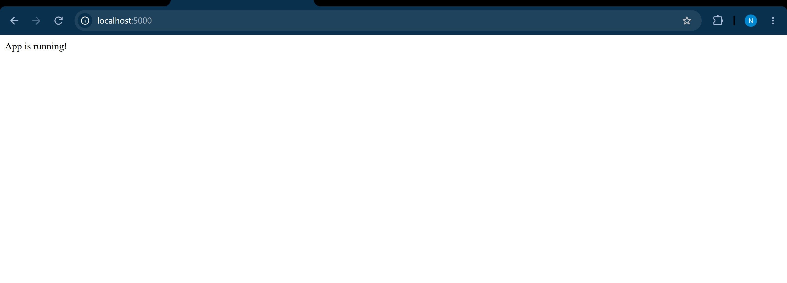
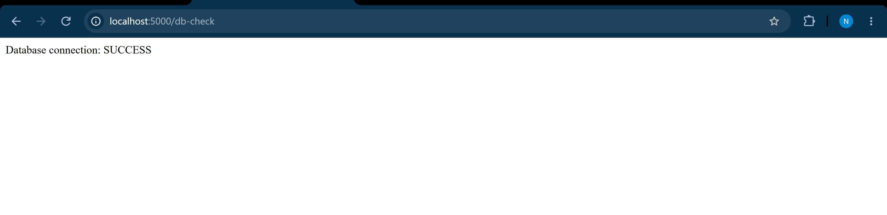
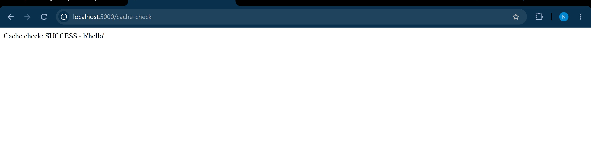

# Multi-Container Docker App (Flask + Postgres + Redis)

A small Flask app demonstrating a multi-container setup using Docker Compose —
app, database, and cache running as separate services on a shared network.

## Stack
- Flask (Python)
- PostgreSQL 16
- Redis

## Run it
docker compose up -d

## Endpoints
- / — health check
- /db-check — verifies database connectivity
- /cache-check — verifies Redis connectivity

## Screenshots

### Home endpoint

### Database connectivity check

### Cache connectivity check

## What I learned
- Multi-container orchestration with Docker Compose
- Service-to-service communication via Docker's internal DNS
- Postgres 18+ changed its default data directory format — pinned to
  postgres:16 to avoid the breaking change
- Persistent storage with named volumes
